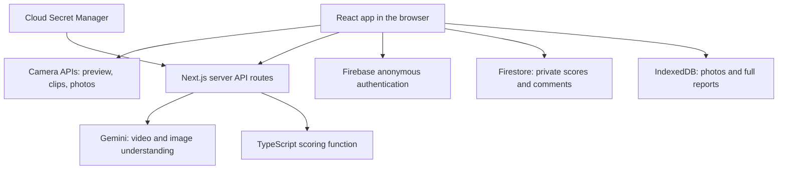

# Drip Score: Our Stack

Drip Score is a camera-based outfit review app. A user shows their outfit, gets specific live comments, poses for three automatic photos, and receives a final score. Their looks feed keeps the photos, scores, and selected comments together.

The frontend and backend are **one Next.js application**, deployed together on Firebase App Hosting. There is no separate Express server or locally hosted backend in production.

## Stack at a glance

- **Next.js 15 / App Router:** pages, routing, and server API endpoints.
- **React 19 + TypeScript:** interactive camera interface, session flow, and typed data.
- **Tailwind CSS 4 + custom CSS:** layout and the minimal camera/feed design.
- **Lucide React:** interface icons.
- **Browser camera APIs:** camera permission, video preview, clip recording, and photo capture.
- **Google Gemini 3.1 Flash Lite:** video understanding, outfit comments, photo analysis, and garment feature estimates.
- **Our TypeScript scoring algorithm:** calculates a rules-based score from the estimated garment features.
- **Firebase Authentication:** anonymous browser identities for private score storage.
- **Cloud Firestore:** score records, rule breakdowns, and selected live comments.
- **IndexedDB:** photos and complete local look reports.
- **Firebase App Hosting:** builds and hosts the full Next.js application using managed Google Cloud infrastructure.
- **Cloud Secret Manager:** stores the production Gemini API key.

Versions above describe the current major versions. `package.json` declares dependencies; `package-lock.json` records the installed versions.

## How the pieces connect



The browser talks to the app's API routes on the same HTTPS domain. It also uses Firebase's browser SDK directly for authentication and Firestore, with access enforced by Firestore Security Rules.

## Frontend and camera

The main interface lives in `frontend/src/App.tsx`. Next.js renders it from `app/page.tsx`; the saved looks page is `/feed`.

The session moves through these stages:

1. Enable the camera and start a three-second countdown.
2. Show the outfit during a 15-second runway. The runway timer begins when clothing is first recognized.
3. Capture three photos automatically at the end. Every photo has a pose prompt and its own full 3–2–1 countdown.
4. Analyze selected snapshots and open the looks feed.

`useCamera.ts` uses `navigator.mediaDevices.getUserMedia()` for the camera. It captures video without audio and uses a canvas to take JPEG snapshots. These are built-in browser APIs, not a third-party camera service. Camera access requires localhost or HTTPS and the user's permission.

`clipCapture.ts` records independently finalized 2.5-second MP4/H.264 clips with `MediaRecorder`. When that recording format is unavailable, it sends a short sequence of timestamped JPEG frames instead. Live video clips stay in a bounded memory buffer; they are not saved to Firestore or a storage bucket.

The app also takes three snapshots during the runway. Those snapshots and the three posed photos remain available in the local feed.

The repository includes MediaPipe person-detection utilities from the earlier interface. The current minimal camera flow does not depend on them or require full-body framing to start.

## Gemini and live comments

The server uses Google's `@google/genai` SDK with **`gemini-3.1-flash-lite`**. The configured thinking level is `low`.

For live comments, the browser sends the latest one or two short clips to `POST /api/comments`. Native video is sampled at two frames per second. The server asks Gemini to:

- Identify actual visible garments, colors, and styling details.
- Combine clear moments across a turn or partial view.
- Give specific compliments and constructive suggestions.
- Link comments to observed clothing pieces.
- Avoid repeating feedback already shown.

The response uses a structured JSON schema. The server checks that each comment refers to an observed piece and that criticism includes an actionable suggestion. The browser maintains a recent outfit inventory, suppresses duplicate comments, and delivers comments at a readable pace.

This is **batched video analysis with paced comment delivery**, not Gemini's Live API or a continuous token stream. Displaying another comment does not itself make another model request.

Up to six comments actually delivered during the runway are retained with the completed look and displayed below the final score in **“From your live.”**

Main files:

- `lib/fitcheck/prompt.ts`: live outfit instructions.
- `app/api/comments/route.ts`: video commentary endpoint and response schema.
- `frontend/src/services/apiProvider.ts`: client requests, pacing, and cancellation.
- `frontend/src/services/outfitSession.ts`: inventory memory and duplicate suppression.

## Final scoring

`POST /api/fitcheck/analyze` receives up to three images from the same session: two runway snapshots and the last posed photo. All three go into **one final Gemini request**.

Gemini returns an independent holistic AI score, a style summary, and feature estimates for the visible garments. These features include fit quality, drape harmony, basic/statement points, visual hierarchy, color family, and visual weight.

Our server then runs the supplied `evaluateOutfit()` function in `lib/fitcheck/outfitScore.ts`:

- **Fit and drape — 55%:** weighted garment fit, drape harmony, and a weakest-core-piece penalty.
- **7–8 point method — 17%:** balance between foundational and statement pieces.
- **Visual hierarchy — 15%:** focal, supporting, and quiet pieces.
- **Continuity — 13%:** shared color families or visual weight across pieces.
- **Fit gate:** multiplies the weighted score by `0.3 + 0.7 × fitScore`.

The rules score is converted from a 0–1 scale to a 0–100 scale, then averaged equally with the AI score:

```text
finalScore = roundToOneDecimal((aiScore + rulesScoreOn100PointScale) / 2)

Example: AI 88 + rules 75 → final 81.5
```

The arithmetic is deterministic, but the garment feature estimates still come from Gemini. This is not a second independent vision model. Partial views are valid; the score covers the pieces that can be seen. Invalid or missing scoring features reject the report instead of being replaced with made-up defaults.

## What we store

**Firestore stores:**

- AI, rules, and final scores.
- The rules breakdown, fit gate, points, and notes.
- A style label, timestamp, and look identifier.
- Up to six selected live comments and their styling suggestions.

Records live at:

```text
users/{anonymousUid}/scores/{lookId}
```

Firebase Authentication creates a persistent anonymous identity for each browser. Security Rules allow only that identity to read, write, or delete its own records. The record schema rejects extra photo fields and bounds score and comment values.

**IndexedDB stores:** the captured photos, full look reports, and local score-sync state, in the `fitcheck-looks` database. The app retries pending score uploads when the feed is opened, without repeating Gemini analysis. Demo looks stay local.

Photos are **not** uploaded to Firestore or Firebase Cloud Storage. Selected clips and images are sent to Google Gemini for analysis; provider processing and retention follow the applicable Google service terms.

Anonymous identity is tied to browser site data. Clearing that data loses the photos and access to that anonymous identity. Permanent account sign-in and cross-device recovery have not been added. Localhost, the Tailscale preview, and the Firebase site also have separate browser storage.

Firestore history is a private personal record, not an authoritative public leaderboard: a client can modify its own score records. Firebase Analytics is not enabled.

Storage code lives in `fitFeed.ts`, `firebaseScores.ts`, and `scoreRecord.ts` under `frontend/src/services/`. Access rules are in `firestore.rules`.

## Backend, secrets, and usage limits

Next.js route handlers run in Node.js. The main endpoints are:

- `GET /api/health`: configuration, model, and revision information; no Gemini request.
- `POST /api/comments`: live outfit video analysis.
- `POST /api/fitcheck/analyze`: multi-photo analysis and blended scoring.

The Gemini key is server-only. Locally it comes from ignored `.env.local`; in production it comes from Cloud Secret Manager through `apphosting.yaml`. It is not a `NEXT_PUBLIC_` variable. The Firebase browser configuration is separate and contains public app identifiers, not the Gemini credential.

Usage controls permit at most two live analyses and one final report attempt per session. The server enforces a ten-second minimum gap, one provider request in flight, and configured ceilings of four calls per minute and 100 per Pacific day. Provider quota errors pause further calls; automatic key/model rotation is not used.

The current hosting configuration permits one instance. Its local counter file uses ephemeral `/tmp`, so restarts and rollouts can reset that app-level ledger. It is not a durable billing cap. Google's project quotas still apply; strict limits across restarts or multiple instances would require a shared counter store.

## Hosting and development

Production URL:

https://drip-score--devfest2026-41803.us-central1.hosted.app

Firebase App Hosting builds the Next.js app, runs its backend on Cloud Run, and serves it through managed HTTPS/CDN infrastructure. The Firebase project is `devfest2026-41803`, the backend is `drip-score`, and the region is `us-central1`. The configured runtime is Node.js 22, with zero minimum instances and a maximum of one instance.

Local development uses `npm run dev` on port 3000. Development output is written to `.next-dev`; production output uses `.next`. The separate directories prevent a production build from overwriting the running dev server's manifests.

Checks use TypeScript, ESLint, and Node's test runner through `tsx`. Tests cover input validation, grounded comments, request budgets, scoring arithmetic, automatic photo countdowns, and the Firestore record allowlist. Live Firestore checks have also verified owner access, cross-user denial, photo-field rejection, and score/comment round trips.

```sh
npm run dev
npm run typecheck
npm run lint
npm test
npm run build
```

Production deployment uses the Firebase CLI. A Git push alone does not deploy this backend:

```sh
firebase deploy --only firestore --project devfest2026-41803
firebase deploy --only apphosting:drip-score --project devfest2026-41803
```

See [FIREBASE.md](FIREBASE.md) for deployment setup and [API_CONTRACT.md](../backend/API_CONTRACT.md) for request and response details.
